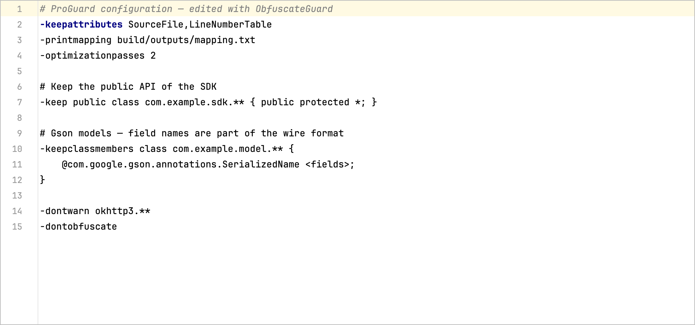
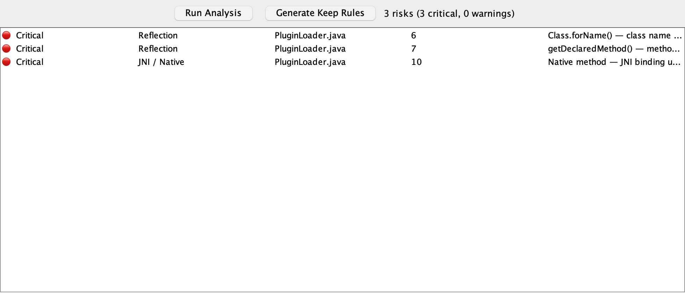
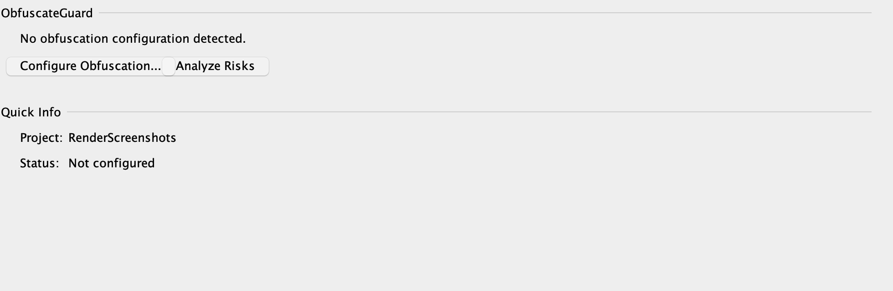

# ObfuscateGuard

[](https://plugins.jetbrains.com/plugin/30234)
[](LICENSE)

> JetBrains IntelliJ Platform plugin pro bezpečnou orchestraci obfuskace Java/Kotlin projektů.

**ObfuscateGuard** není obfuskátor — je to **workflow, analýza a governance vrstva** nad ProGuard/R8 přímo v IDE.

## Klíčové funkce

- **Configuration Wizard** — nastavení obfuskace bez studia 40stránkových manuálů
- **Chytrý editor .pro souborů** — syntax highlighting, code completion a rychlá dokumentace (Ctrl+Q) pro 50+ direktiv
- **Config Linter** — neznámé direktivy s návrhem opravy překlepu, nebezpečné volby (`-dontobfuscate`, `-ignorewarnings`, plošný `-dontwarn`), duplicity
- **Safe-mode Analyzer** — automatická detekce rizik (reflection, serialization, JNI, DI) a generování keep rules
- **Export Keep Rules** — zápis vygenerovaných pravidel do `proguard-rules.pro` se zachováním ručně psaného obsahu
- **Dry-run Validation** — ověření, že obfuskace nerozbije aplikaci, včetně vynucení týmové policy
- **Stack Trace Deobfuscator** — retrace crash logů včetně R8 line-range mappingů, auto-detekce mapping souboru
- **CI/CD Export** — šablony pro GitHub Actions, GitLab CI a Jenkins
- **Policy Engine** — týmová pravidla v `obfuscateguard-policy.json` sdílená přes VCS

## Screenshoty

| Editor .pro souborů s lintingem | Analýza rizik |
|---|---|
|  |  |



## Týmová policy

Vytvořte `obfuscateguard-policy.json` v kořeni projektu a commitněte do VCS:

```json
{
  "minLevel": "STANDARD",
  "requireMappingOutput": true,
  "requiredKeepAttributes": ["SourceFile", "LineNumberTable"],
  "forbiddenDirectives": ["-dontobfuscate", "-ignorewarnings"],
  "maxUncoveredCriticalRisks": 0
}
```

Dry-run validace (Tools → ObfuscateGuard → Dry-Run Validation) policy vynucuje a hlásí porušení.

## Vývoj

```bash
./gradlew detekt test     # statická analýza + unit/platform testy
./gradlew buildPlugin     # distribuce do build/distributions
./gradlew runIde          # sandbox IDE s pluginem

# regenerace screenshotů z reálného UI
./gradlew test --tests "*ScreenshotGeneratorTest*" -PscreenshotsDir=$(pwd)/docs/screenshots
```

## Tech Stack

- Kotlin | IntelliJ Platform SDK | Gradle

## Free & open source

As of version 2026.8.0 this plugin is completely free — every feature is unlocked and no license is needed. The source code is available at https://github.com/JirakJ/obfuscate-guard under the Apache License 2.0.

## Contributing

Issues and pull requests are welcome — please open them on GitHub.

## License

Copyright 2026 Jakub Jirák. Licensed under the [Apache License, Version 2.0](LICENSE).
